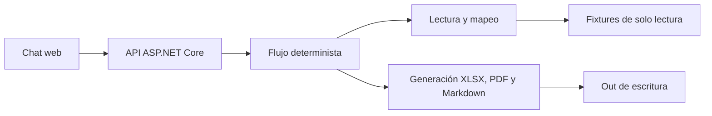

# Solución — agente de registro como proveedor

## 1. Problema

El área administrativa transcribe repetidamente información de Periferia IT Group a formularios de clientes y busca soportes para cada registro. Esta solución prepara un paquete trazable para revisión, firma y envío humano.

## 2. Arquitectura

Alternativa textual: el navegador llama la API de ASP.NET Core. El backend identifica el caso solicitado, lee la solicitud y plantilla, mapea cada etiqueta contra el maestro mediante el glosario, genera el formato de salida y arma el paquete en `out/`. La sesión y la confirmación se mantienen en memoria.

## 3. Ciclo de procesamiento

El modo implementado es determinista, sin API key ni modelo de lenguaje:

1. Lee solicitud, país, formato, campos y soportes requeridos.
2. Mapea campos al maestro y clasifica `lleno`, `faltante` o `requiere_confirmacion`.
3. Genera Excel, PDF o valores para portal.
4. Copia soportes y crea checklist más borrador de correo.
5. Solicita confirmación humana.
6. Solo después de `confirmo`, crea `ENVIO-SIMULADO.md`; no se envía ningún correo real.

Las herramientas se muestran en el chat con nombre, argumentos y resumen. Cada ejecución queda registrada en `out/<caso>/log.jsonl`.

## 4. Modelo de lenguaje

La demo no consume un LLM: usa un flujo determinista porque los casos, el maestro y las reglas vienen estructurados en los fixtures. Esto permite probar el caso completo sin API key, costo o instalación adicional.

Si se requiere LLM en una fase posterior, se agregaría un adaptador en .NET que transforme las cinco acciones del proceso en herramientas y gestione el ciclo `modelo → herramienta → modelo`. La fuente de datos seguiría siendo el maestro; el modelo no podría inventar valores ni ejecutar envío sin confirmación.

## 5. Portales web

El formato `portal` se marca explícitamente como no soportado y genera `valores-portal.md`. Para producción se recomienda navegador controlado o RPA con selectores versionados. CAPTCHA, MFA, ingreso de credenciales y clic final de envío se mantienen como responsabilidad humana. Las credenciales deben vivir en un vault, nunca en código, prompt o logs.

## 6. Decisiones y trade-offs

1. **.NET 8 y dependencias estándar**: permite ejecutar el backend en el entorno disponible, sin Node.js ni paquetes externos. Se descartó depender de npm porque no estaba instalado.
2. **Flujo determinista**: prioriza trazabilidad y evita alucinaciones para entradas estructuradas. Un LLM se deja como ampliación opcional para solicitudes menos normalizadas.
3. **Generación local de XLSX y PDF**: se producen archivos con extensión y estructura válidas sin automatizar aplicaciones de escritorio. Se descarta Office/RPA por portabilidad.
4. **Sistema de archivos y memoria**: es suficiente para el reto. En producción se requerirían persistencia, autenticación, cifrado y políticas de retención.
5. **Portal no automatizado**: reduce riesgo de credenciales, MFA y cambios de interfaz.

## 7. Supuestos

- Los JSON de plantillas representan los campos que solicita cada cliente.
- Los archivos de soporte `.txt` son sustitutos de documentos reales.
- Las fechas de vigencia se evalúan contra la fecha de ejecución.
- Un campo faltante o pendiente de confirmación se reporta, pero no bloquea la firma; únicamente soportes ausentes o vencidos bloquean `listo_para_firma`.

## 8. Cobertura

| Historia | Estado | Evidencia |
|---|---|---|
| HU-1 Leer solicitud | Hecho | Lee solicitud, plantilla y soportes de cada caso. |
| HU-2 Mapear campos | Hecho | Usa glosario, rutas y regla de identificador extranjero. |
| HU-3 Generar formato | Hecho | Genera XLSX, PDF y Markdown para portal no soportado. |
| HU-4 Paquete de firma | Hecho | Copia soportes, crea checklist, correo sin datos bancarios y envío simulado confirmado. |
| HU-5 Manejo de errores | Parcial | Errores se muestran en lenguaje claro; falta aislar cada paso como resultado estructurado independiente. |

Validaciones ejecutadas: compilación .NET exitosa, los cuatro casos procesados, comprobación de cabecera ZIP del XLSX, cabecera `%PDF-1.4`, archivo de portal y envío simulado posterior a confirmación.

## 9. Uso de IA

Se utilizó PERXIA para analizar el PRD, diseñar la estructura, implementar y revisar la solución. Se descartó automatizar firma, envío real y portal porque están fuera del alcance y requieren control humano.

## 10. Riesgos y mitigación

- **Datos maestros desactualizados**: asignar dueño del dato y controlar vigencias.
- **Plantillas reales variables**: validar entrada, crear cola de excepciones y ampliar pruebas.
- **Datos sensibles**: aplicar cifrado, autenticación y vault en producción.
- **Sin enlace público**: se demuestra en local; para producción se debe desplegar en infraestructura aprobada.
